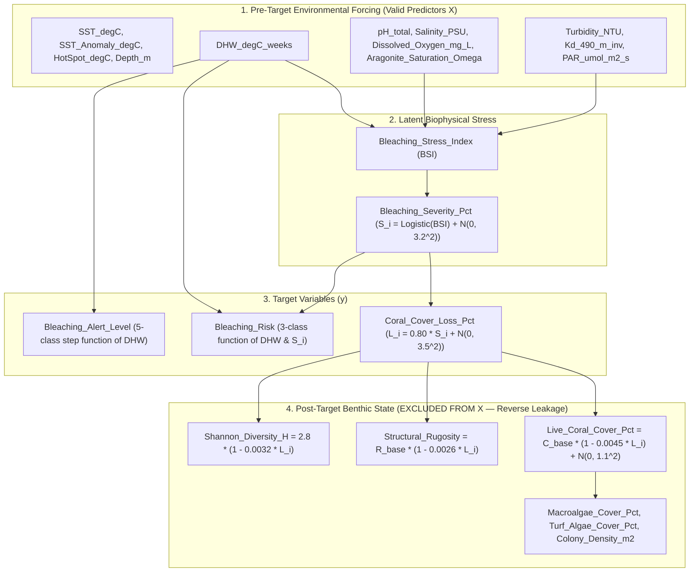

# Target Construction, Functional Dependencies, and Leakage Remediation (`FON-01` / `FON-02`)

**Document ID:** `05_Methodology/target_construction.md`  
**Audit Findings Addressed:** `FON-01` (Reverse Target Leakage via Post-Target Benthic Variables), `FON-02` (Deterministic Target Construction & Feature Ablation), `CRIT-03` (3-Class vs. 5-Class Target Discrepancy)  
**Primary Generator Script:** `03_Data/build_final_dataset.py` (`SEED = 42`, $N = 15,000$ rows across 30 stations)  
**Legacy Secondary Generator (Archived):** `legacy/03_Data/generate_datasets.py` ($N = 12,500$ rows across 25 stations)

---

## 1. Exact Mathematical Formulation of Synthetic Target Variables

In `03_Data/build_final_dataset.py`, every record $i \in \{1, \dots, 15000\}$ is generated sequentially within the station-time loop. The target variables are constructed directly from four environmental forcing variables:
- `DHW_degC_weeks` ($\text{DHW}_i$)
- `Aragonite_Saturation_Omega` ($\Omega_{\text{arag}, i}$)
- `PAR_umol_m2_s` ($\text{PAR}_i$)
- `Turbidity_NTU` ($\text{Turb}_i$)

### 1.1 Latent Multi-Stressor Bleaching Stress Index ($\text{BSI}_i$)
In `03_Data/build_final_dataset.py` (lines 171–181):
$$\text{acid\_penalty}_i = \frac{\max(3.8 - \Omega_{\text{arag}, i},\; 0.0)}{1.4}$$
$$\text{light\_penalty}_i = \frac{\max(\text{PAR}_i - 1100.0,\; 0.0)}{1000.0}$$
$$\text{turb\_buffer}_i = \min\!\left(\frac{\text{Turb}_i}{6.0},\; 0.25\right)$$
$$\text{BSI}_i = \max\!\left(0.60 \left(\frac{\text{DHW}_i}{8.0}\right)^{1.8} + 0.24\,\text{acid\_penalty}_i + 0.16\,\text{light\_penalty}_i - 0.10\,\text{turb\_buffer}_i,\; 0.0\right)$$

*(Note: In the archived `legacy/03_Data/generate_datasets.py` lines 182–188, slightly different coefficients were used: $0.62 (\text{DHW}/8.0)^{1.8} + 0.22 ((3.8 - \min(\Omega_{\text{arag}}, 3.8))/1.5) + 0.16 ((\text{PAR}-1000)/1000) - 0.08 (\text{Turb}/5.0)$).*

### 1.2 Latent Logistic Bleaching Severity (`Bleaching_Severity_Pct`, $S_i$)
In `03_Data/build_final_dataset.py` (lines 184–185), $\text{BSI}_i$ is passed through a logistic sigmoid function with additive zero-mean Gaussian noise $\varepsilon_{S, i} \sim \mathcal{N}(0, 3.2^2)$:
$$S_i = \text{clip}\!\left(\frac{100.0}{1.0 + \exp\!\big(-3.4\,(\text{BSI}_i - 0.88)\big)} + \varepsilon_{S, i},\; 0.0,\; 100.0\right), \quad \varepsilon_{S, i} \sim \mathcal{N}(0, 3.2^2)$$

*(In `legacy/03_Data/generate_datasets.py` lines 191–192, the logistic slope was $-3.2$, midpoint $0.90$, and noise $\mathcal{N}(0, 3.5^2)$).*

### 1.3 Auxiliary 5-Class Target: `Bleaching_Alert_Level`
In `03_Data/build_final_dataset.py` (lines 188–197), `Bleaching_Alert_Level` is a **100% deterministic step function of `DHW_degC_weeks` alone** (with zero stochastic noise):

$$\text{Bleaching\_Alert\_Level}_i = \begin{cases}
\texttt{No\_Stress}, & \text{if } \text{DHW}_i = 0.0 \quad (N = 10,508;\; 70.05\%) \\
\texttt{Watch}, & \text{if } 0.0 < \text{DHW}_i < 1.0 \quad (N = 3,375;\; 22.50\%) \\
\texttt{Warning}, & \text{if } 1.0 \le \text{DHW}_i < 4.0 \quad (N = 379;\; 2.53\%) \\
\texttt{Alert\_Level\_1}, & \text{if } 4.0 \le \text{DHW}_i < 8.0 \quad (N = 21;\; 0.14\%) \\
\texttt{Alert\_Level\_2}, & \text{if } \text{DHW}_i \ge 8.0 \quad (N = 717;\; 4.78\%)
\end{cases}$$

Because `Bleaching_Alert_Level` is a noise-free threshold rule on `DHW_degC_weeks`, any decision tree with access to `DHW_degC_weeks` trivially partitions the thresholds at $\{0, 1, 4, 8\}$. Furthermore, `Alert_Level_1` contains only 21 samples across the entire 15,000-row dataset ($0.14\%$).

### 1.4 Primary 3-Class Classification Target: `Bleaching_Risk`
In `03_Data/build_final_dataset.py` (lines 200–205), `Bleaching_Risk` combines `DHW_degC_weeks` and the noisy `Bleaching_Severity_Pct` ($S_i$):

$$\text{Bleaching\_Risk}_i = \begin{cases}
\texttt{Low}, & \text{if } \text{DHW}_i < 4.0 \text{ and } S_i < 15.0 \quad (N = 14,097;\; 93.98\%) \\
\texttt{Medium}, & \text{else if } \text{DHW}_i < 8.0 \text{ and } S_i < 50.0 \quad (N = 186;\; 1.24\%) \\
\texttt{High}, & \text{otherwise } (\text{DHW}_i \ge 8.0 \text{ or } S_i \ge 50.0) \quad (N = 717;\; 4.78\%)
\end{cases}$$

### 1.5 Continuous Regression Target: `Coral_Cover_Loss_Pct` ($L_i$)
In `03_Data/build_final_dataset.py` (line 208), `Coral_Cover_Loss_Pct` ($L_i$) is computed as a linear scaling of `Bleaching_Severity_Pct` ($S_i$) plus independent Gaussian noise $\varepsilon_{L, i} \sim \mathcal{N}(0, 3.5^2)$:

$$L_i = \text{clip}\!\left(0.80\,S_i + \varepsilon_{L, i},\; 0.0,\; 96.0\right), \quad \varepsilon_{L, i} \sim \mathcal{N}(0, 3.5^2)$$

*(In `legacy/03_Data/generate_datasets.py` line 203, the equation was $L_i = \text{clip}(0.78\,S_i + \mathcal{N}(0, 4.0^2), 0.0, 95.0)$).*

#### Theoretical Ceiling on $R^2$ for Predicting $L_i$ from Pre-Target Environmental Drivers
Because $S_i$ includes irreducible Gaussian noise $\varepsilon_{S, i} \sim \mathcal{N}(0, 3.2^2)$ (which is NOT included in the predictor matrix $X$) and $L_i$ adds independent Gaussian noise $\varepsilon_{L, i} \sim \mathcal{N}(0, 3.5^2)$, the total unexplainable variance between the deterministic environmental signal $f(X_i) = 0.80 \cdot \frac{100}{1 + \exp(-3.4(\text{BSI}_i - 0.88))}$ and $L_i$ (prior to boundary clipping at $0.0$) is:
$$\text{Var}(\text{noise}) = (0.80 \times 3.2)^2 + 3.5^2 = 6.5536 + 12.25 = 18.8036 \implies \sigma_{\text{irreducible}} \approx 4.34\% \text{ (unclipped)}, \quad \text{RMSE}_{\min} \approx 3.89\% \text{ (clipped)}$$
Given the sample variance of `Coral_Cover_Loss_Pct` across $N = 15,000$ ($\text{Var}(L) = 246.20$, $\sigma_L = 15.69\%$, mean $9.06\%$), the **maximum theoretically achievable $R^2$** by any model using only pre-target environmental variables is:
$$R^2_{\max} = 1 - \frac{\text{MSE}_{\min}}{\text{Var}(L)} \approx 1 - \frac{3.89^2}{246.20} \approx 0.9385$$
Any model reporting $R^2 \approx 0.9995$ and $\text{RMSE} \approx 0.346\%$ (as in the legacy `compare_rf_xgb_lstm.py`) **necessarily suffers from reverse target leakage** (`Shannon_Diversity_H`), which artificially reduces $\text{RMSE}$ by an order of magnitude below the irreducible noise floor ($\approx 3.89\%$).

---

## 2. Mathematical Proof of Reverse Target Leakage (`FON-01`)

In `03_Data/build_final_dataset.py` (lines 211–218), six benthic ecological state variables are computed **after** `Coral_Cover_Loss_Pct` ($L_i$) as explicit mathematical functions of $L_i$:

1. **`Shannon_Diversity_H` ($H'_i$) — Deterministic, Zero-Noise Linear Function of $L_i$ (Line 217):**
   $$H'_i = \text{round}\!\left(\max\!\left(2.8 \times \left(1.0 - 0.0032\,L_i\right),\; 0.30\right),\; 2\right)$$
   - Notice that in `build_final_dataset.py`, the baseline constant $2.8$ is **universal across all 30 stations**, and there is **zero stochastic noise** added!
   - Since $L_i \in [0, 96]$, $2.8(1 - 0.0032 L_i) \ge 2.8(1 - 0.3072) = 1.94 > 0.30$, so the $\max(\cdot, 0.30)$ floor is never active.
   - Therefore, $L_i$ is an exact affine inversion of `Shannon_Diversity_H` up to 2-decimal rounding ($\Delta H' = \pm 0.005$):
     $$L_i \approx \frac{1.0 - H'_i / 2.8}{0.0032} = 312.5 - 111.6071\,H'_i$$
   - The rounding step size of $0.01$ in $H'_i$ corresponds to a step of $1.116\%$ in $L_i$, whose uniform quantization error has standard deviation $\frac{1.116}{\sqrt{12}} \approx 0.322\%$.
   - When `legacy/06_AI_and_Modeling/compare_rf_xgb_lstm.py` (line 41) and `legacy/06_AI_and_Modeling/model_evaluation/evaluate_models.py` (line 45) included `Shannon_Diversity_H` in the feature matrix $X$, Random Forest and XGBoost simply inverted `Shannon_Diversity_H`, producing the artificial **$R^2 = 0.9995$ and $\text{RMSE} = 0.346\%$**.

2. **`Structural_Rugosity` ($R_i$) — Station-Scaled Linear Function of $L_i$ (Line 216):**
   $$R_i = \text{round}\!\left(\max\!\left(R_{\text{base}, \text{st}} \times \left(1.0 - 0.0026\,L_i\right),\; 1.05\right),\; 2\right)$$
   where $R_{\text{base}, \text{st}}$ is constant within each station.

3. **`Live_Coral_Cover_Pct` ($C_{\text{live}, i}$) — Noisy Linear Function of $L_i$ (Line 211):**
   $$C_{\text{live}, i} = \max\!\left(C_{\text{base}, \text{st}} \times \left(1.0 - 0.0045\,L_i\right) + \mathcal{N}(0, 1.1^2),\; 1.8\right)$$

4. **`Macroalgae_Cover_Pct`, `Turf_Algae_Cover_Pct`, and `Colony_Density_m2` (Lines 212–213, 218):**
   $$\text{Macroalgae}_i = \text{clip}\!\left(100.0 - C_{\text{live}, i} - \mathcal{U}(22.0, 48.0),\; 4.0,\; 86.0\right)$$
   $$\text{Turf}_i = \max\!\left(100.0 - C_{\text{live}, i} - \text{Macroalgae}_i,\; 0.0\right)$$
   $$\text{Colony\_Density}_i = \max\!\left(14.0 \times \frac{C_{\text{live}, i}}{35.0} + \mathcal{N}(0, 0.8^2),\; 0.5\right)$$

### Causal DAG of the Data Generator

---

## 3. Unified Feature Selection & Terminology Remediation

### 3.1 Mandatory Exclusion of Post-Target Variables from $X$
To eliminate reverse target leakage (`FON-01`), the following 7 post-target and latent variables are **strictly prohibited** from appearing in any predictor matrix $X$:
1. `Shannon_Diversity_H`
2. `Structural_Rugosity`
3. `Live_Coral_Cover_Pct`
4. `Macroalgae_Cover_Pct`
5. `Turf_Algae_Cover_Pct`
6. `Colony_Density_m2`
7. `Bleaching_Severity_Pct`

### 3.2 Clean Pre-Target Feature Sets for Ablation Experiments
All modeling and cross-validation pipelines (`train_models.py`, `evaluate_models.py`, `compare_rf_xgb_lstm.py`) are standardized on three leakage-free feature configurations:

| Configuration | Features Included ($p$) | Exact Column Names | Scientific Interpretation |
| :--- | :---: | :--- | :--- |
| **Config A (`full_12_clean`)** | 12 | `Depth_m`, `SST_degC`, `SST_Anomaly_degC`, `HotSpot_degC`, `DHW_degC_weeks`, `pH_total`, `Salinity_PSU`, `Dissolved_Oxygen_mg_L`, `Aragonite_Saturation_Omega`, `Turbidity_NTU`, `Kd_490_m_inv`, `PAR_umol_m2_s` | **Statistical Emulation of the Coupled Biophysical Model**: Recovers the non-linear multi-stressor response surface up to the irreducible noise ceiling ($R^2 \approx 0.936$, $\text{RMSE} \approx 3.96\%$). |
| **Config B (`no_dhw_11`)** | 11 | Config A minus `DHW_degC_weeks` | **Instantaneous Thermal & Biogeochemical Emulation**: Tests sensitivity when accumulated 12-week thermal stress (`DHW_degC_weeks`) is removed and inferred from `HotSpot_degC`, `SST_degC`, and `SST_Anomaly_degC`. |
| **Config C (`ambient_8`)** | 8 | `Depth_m`, `SST_degC`, `SST_Anomaly_degC`, `HotSpot_degC`, `pH_total`, `Salinity_PSU`, `Dissolved_Oxygen_mg_L`, `Kd_490_m_inv` | **Indirect Ambient Proxies Only**: Excludes all 4 direct formula inputs (`DHW_degC_weeks`, `Aragonite_Saturation_Omega`, `Turbidity_NTU`, `PAR_umol_m2_s`), testing surrogate inference purely from ambient physical/chemical proxies. |

### 3.3 Mandatory Terminology: Statistical Emulation vs. Empirical Prediction
Because the 15,000-row dataset is 100.0% synthetically generated by the coupled numerical equations in `03_Data/build_final_dataset.py` (`SEED = 42`), training machine learning and deep learning models on $(X, y)$ does **not** constitute empirical ecological forecasting or real-world validation. Instead, it constitutes **statistical emulation (surrogate modeling) of the coupled biophysical rules** (*emulación estadística del modelo biofísico acoplado*). All manuscript sections, tables, and figures must use this exact terminology.
